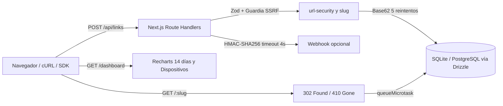

# SnipLink Dev

[](./.github/workflows/ci.yml)

**Acortador de enlaces para desarrolladores sin fricción**, con slugs criptográficos Base62, vista previa OpenGraph protegida contra SSRF, telemetría de clics no bloqueante vía HTTP `302`, expiración determinista `410 Gone` por TTL/máximo de clics, API Keys SHA-256, errores RFC 7807 Problem Details y documentación OpenAPI 3.1.0.

> **Demo en 5 segundos (sin registro):** Inicia la aplicación y abre [`http://localhost:3001/demo`](http://localhost:3001/demo) o [`/dashboard`](http://localhost:3001/dashboard) con enlaces precargados, analíticas en Recharts y códigos QR descargables en SVG/PNG.

---

## Arquitectura



---

## Decisiones Técnicas Clave (ADRs)

| Decisión | Elección | Por qué |
| --- | --- | --- |
| **Código de redirección** | `302 Found` + `Cache-Control: no-store` en lugar de `301` | Los navegadores cachean `301` de forma permanente, rompiendo el conteo de clics y saltándose la validación de expiración `410 Gone`. |
| **Generación de slugs** | Base62 de 7 caracteres (`crypto.randomBytes` con rejection sampling) + 5 reintentos | Evita IDs secuenciales predecibles y sesgo de módulo, acotando colisiones en BD con costo esperado $O(1)$. |
| **Deduplicación de enlaces** | Modo anónimo deduplica; modo campaña (`userId` / API key) crea slugs distintos | Mantiene idempotente el uso rápido sin cuenta, mientras permite a equipos medir campañas separadas hacia la misma URL destino. |

---

## Ejecución Local en 3 Pasos (`pnpm`)

```bash
pnpm install
pnpm db:migrate && pnpm db:seed
pnpm dev
```

Abre `http://localhost:3001` (o `/demo` para probar el acortador y las analíticas al instante).

### Variables de Entorno

| Variable | Valor por defecto | Descripción |
| --- | --- | --- |
| `DATABASE_URL` | `file:./data/sniplink.db` | Ruta del archivo SQLite local o `:memory:` en tests |
| `POSTGRES_URL` | *(opcional)* | Cadena de conexión PostgreSQL 17 (`docker-compose.yml`) |
| `NEXT_PUBLIC_APP_URL` | `http://localhost:3001` | Origen canónico para enlaces cortos y servidor OpenAPI |
| `WEBHOOK_URL` | *(opcional)* | URL destino para webhooks `link.created` firmados con HMAC-SHA256 |
| `WEBHOOK_SECRET` | *(opcional)* | Secreto para firmar el header `X-Portfolio-Signature` |
| `RATE_LIMIT_MAX` | `40` | Máximo de peticiones `POST /api/links` por IP cada 60s |

---

## Trade-offs Honestos (100 → 100k Usuarios)

1. **Rate limiter por IP en memoria** (`src/lib/rate-limit.ts`): Ventana deslizante sin dependencias externas ideal para una sola instancia Node; múltiples réplicas requieren Redis/Upstash para compartir contadores.
2. **SQLite embebido + telemetría con `queueMicrotask`**: Ofrece lecturas locales sub-milisegundo y redirecciones no bloqueantes; ante alta concurrencia de escritura (100k usuarios) conviene migrar a PostgreSQL (`docker-compose.yml`) y una cola durable para eventos de clic.
3. **Scraping OpenGraph en vivo con guardia SSRF**: Bloquea rangos privados y loopback en `GET /api/og-preview`; a gran escala, la defensa total contra *DNS rebinding* requiere fijar la IP resuelta al abrir el socket.
