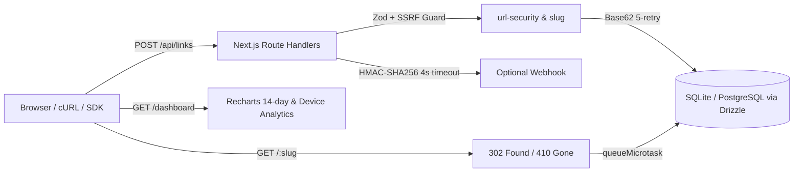

# SnipLink Dev

[](./.github/workflows/ci.yml)

**Zero-friction developer URL shortener** with cryptographic Base62 slugs, SSRF-guarded OpenGraph previews, non-blocking HTTP 302 click telemetry, deterministic `410 Gone` TTL/max-clicks enforcement, SHA-256 API keys, RFC 7807 Problem Details, and OpenAPI 3.1.0 docs.

> **5-second Demo (no login):** Start the app and open [`http://localhost:3001/demo`](http://localhost:3001/demo) or [`/dashboard`](http://localhost:3001/dashboard) with pre-seeded links, Recharts telemetry, and downloadable SVG/PNG QR codes.

---

## Architecture



---

## Architecture Decision Records (ADRs)

| Decision | Choice | Why |
| --- | --- | --- |
| **Redirect Status** | `302 Found` + `Cache-Control: no-store` over `301` | Browsers cache `301` permanently, starving click telemetry and bypassing `410 Gone` TTL/max-clicks checks. |
| **Slug Generation** | 7-char Base62 (`crypto.randomBytes` rejection sampling) + 5-attempt retry | Avoids predictable sequential IDs and modulo bias while bounding DB collision retries under `O(1)` expected attempts. |
| **Link Deduplication** | Anonymous mode deduplicates; Campaign mode (`userId` / API key) creates distinct slugs | Keeps ad-hoc sharing clean and idempotent while allowing teams to track separate campaigns for the same destination URL. |

---

## Quick Start (3 Steps with `pnpm`)

```bash
pnpm install
pnpm db:migrate && pnpm db:seed
pnpm dev
```

Open `http://localhost:3001` (or `/demo` for instant sandbox + analytics).

### Environment Variables

| Variable | Default | Description |
| --- | --- | --- |
| `DATABASE_URL` | `file:./data/sniplink.db` | SQLite file path or `:memory:` for tests |
| `POSTGRES_URL` | *(optional)* | PostgreSQL connection URL (e.g. `docker-compose.yml` Postgres 17) |
| `NEXT_PUBLIC_APP_URL` | `http://localhost:3001` | Canonical origin for short URLs and OpenAPI server |
| `WEBHOOK_URL` | *(optional)* | Target URL for HMAC-SHA256 `link.created` webhooks |
| `WEBHOOK_SECRET` | *(optional)* | Secret used to sign `X-Portfolio-Signature` |
| `RATE_LIMIT_MAX` | `40` | Max `POST /api/links` requests per IP per 60s window |

---

## Honest Trade-offs (100 → 100k Users)

1. **In-memory IP rate limiter** (`src/lib/rate-limit.ts`): Zero-dependency sliding window works great for a single Node instance; multi-instance deployments need Redis/Upstash to share counters.
2. **Embedded SQLite default + `queueMicrotask` telemetry**: Gives sub-millisecond local reads and non-blocking redirects, but high-write concurrency at 100k users should switch to PostgreSQL (`docker-compose.yml`) and a durable queue for click events.
3. **Live OpenGraph scraping with SSRF guard**: Blocks private/loopback CIDRs on `GET /api/og-preview`, though DNS rebinding protection at scale would require pinning the resolved IP at socket connect time.
